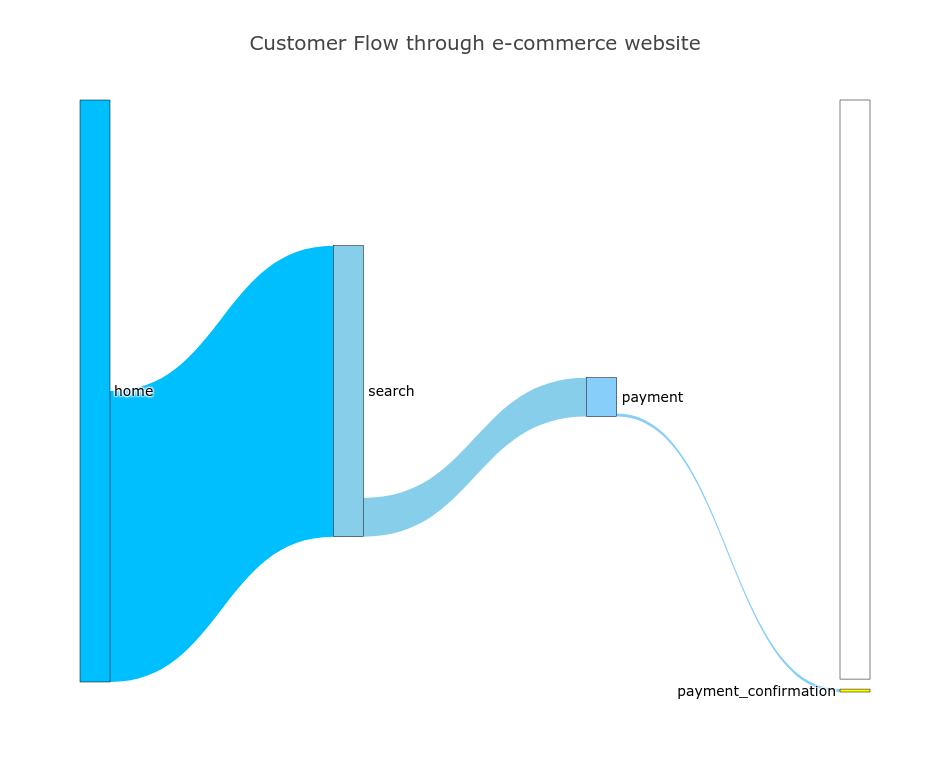

# Agenda 

1. **Problem Statement**: Explore the conversion funnel of an e-commerce website to suggest ways of improving the conversion rate.
2. **Data**: E-commerce website visitor history: [Dataset](https://www.kaggle.com/aerodinamicc/ecommerce-website-funnel-analysis)
3. **Exploratory Analysis**: 
* Sankey Diagram Visualization
* Bivariate Analysis
4. **Results & Insights**:
* Conversion rate dropped on March 1st, 2015 from the home page to the search page by 75% for Mobile users.

# Problem Statement

This analysis walks the conversion funnel of a deliberately simple e-commerce site with just four pages: visitors land on the home page, run a search to reach the search page, click a product to reach the payment page, and, if they decide to buy, arrive at the confirmation page. Framing the journey this explicitly is what later lets us pinpoint exactly where users drop off.

The company CEO isn't thrilled with the volume of sales and, especially, of sales coming from new users. Our goal is to investigate whether there is something wrong in the conversion funnel or, in general, if we can suggest how the conversion rate can be improved.

# Data

We are using the [E-commerce Website Data Set](https://www.kaggle.com/aerodinamicc/ecommerce-website-funnel-analysis) freely available on the Kaggle website.

For every page, the corresponding csv contains a list of user_id's that visited that page and a categorical column called page. The user table contains information about the date the user accessed the website as well as the gender and device used. Data is for visitors to the site from 1/1/2015 - 4/30/2015.

# Exploratory Analysis

Observations:
* Home to Search : 
    * Conversion Rate: 50% (45,200/90,400)
    * From the sankey visualization, it appears we are doing a good job of converting customers from the home page to the search page. Ways in which we can improve conversion from home to search include **A/B testing** the _headline, Call To Action, logo,_ and _search and navigation bar_.
* Search to Payment: 
    * Conversion Rate: 13% (6,030/45,200) 
    * We can improve our search algorithm by using better NLP methods to provide faster - 1d-CNNs as opposed to RNNs - and more accurate results. 
    * The auto-fill algorithm can be improved and tested to measure improvement.
* Payment to Payment_Confirmation: 
    * Conversion Rate: 7.5% (452/6,030)
    * We can use a heatmap to see what parts of the screen the user spends the most time on to get a better insight on what's detracting the user away from the payment_confirmation page. 
    * A/B test a variety of pages: a version with no **up-sells** and **cross-sells**, a version with up-selling and cross-selling, and a version showing similar products to the one being purchased. 

On March 1st, there was a very sharp decline in the number of mobile users converting from the home to the search page. We need to investigate further why we **lost 75% of mobile users**! Perhaps there was an upgrade to the search feature on the website that wasn't mobile friendly?

The graph above displays a sharp **75% drop in conversion rate** for both mobile and desktop users on March 1st. It appears that some combination of features were put into production and resulted in a sharp drop in conversion across pages.
 
# Results & Insights

* There is a sharp drop in the number of mobile users landing on the search page from the home page.
* We also see a steep drop in conversion rate for all users landing on the payment page from the search page. Further investigation into the update rollout schedule should shed some light. 

**Full code**: [Github](https://github.com/hacheemaster/E-commerce_website_conversion_funnel_analysis/blob/master/Conversion%20funnel%20analysis%20for%20e-commerce%20website.ipynb)
