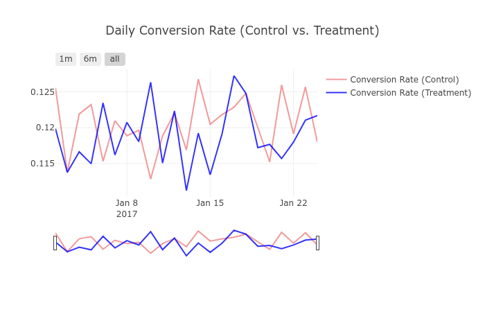

# Agenda 

1. **Problem Statement**: Analyze A/B testing data from an e-commerce website and help them decide whether they should keep the older version of the landing page, implement the newer one, or run the experiment longer.
2. **Data**: E-commerce A/B Testing: [Dataset](https://www.kaggle.com/zhangluyuan/ab-testing)
3. **Results & Insights**:
* A Z-test comparing the proportions of people that converted in each group demonstrated that there wasn't a significant difference between conversion rates.

# Problem Statement

An e-commerce company has run an A/B test on two versions of its landing page and now has to make a call: ship the new page, keep the old one, or let the experiment run longer. The value here lies less in the winner than in the discipline, fixing the hypotheses, error rates, and required sample size up front so the decision rests on evidence rather than a glance at the numbers.

* Null Hypothesis:  ConversionNew - ConversionOld = 0
* Alternative Hypothesis: ConversionNew - ConversionOld > 0

Let's set our risk tolerance for the **type I error at .05** (i.e., 5% of the time we say there is an effect when there is none) and the type II error at 0.2, or equivalently the **power at 0.8** (i.e., 80% of the time when there is an effect, we detect it). Finally, let's **detect a minimum effect size of 3.1%**.

Based on [Optimizely's sample size calculator](https://www.optimizely.com/sample-size-calculator/?conversion=12&effect=3&significance=95), we need 140,000 samples per variation based on our experimental setup.

# Data

After removing duplicates and mislabeled data, we can create a timeseries plot of the daily conversion rates to inspect any differences between the control and treatment groups.

Observations: 
* Conversion Rate (Control) = 12.04%
* Conversion Rate (Treatment) = 11.88%
* The conversion rates are not diverging, which points towards the null hypothesis.

# Results & Insights

Since we have timestamped data, we could theoretically run a hypothesis test continuously as each observation comes in. However, then we need to correct for the **multiple comparison** problem. For simplicity's sake, let's consider we only get to decide once all the data is collected. We can use a z-test to verify whether there is a significant difference in our proportions. 

The z-score gives the normalized deviation from the mean, and we can see that our z-score of -1.31 is less than the critical value of 1.645  for right-tailed 95% confidence. The p-value indicates, under the null hypothesis where we assumed a 0 difference, there's a 90.5% chance of observing a difference this large or larger. Since it's highly likely to observe this difference (i.e., it is well above our 5% threshold), we cannot reject the null hypothesis that there is no difference in conversion rates between the old and new pages. Therefore, the test should be ended to conserve resources. We can move forward by A/B testing other features on our page (Call-To-Action Button, CTA Text, Media, Placement) to see where we can get a lift.

**Full code**: [Github](https://github.com/hacheemaster/AB_Testing)
