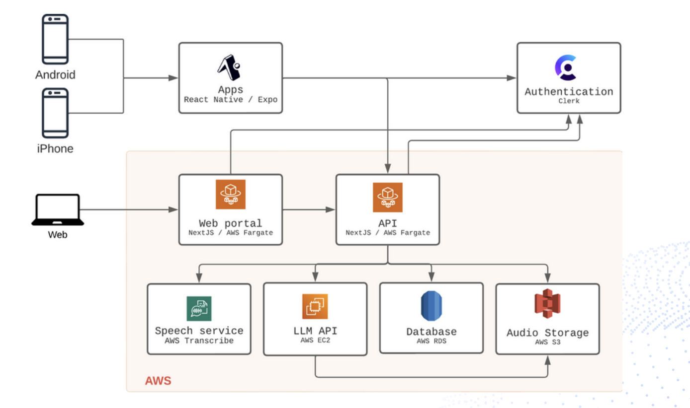

> High-level overview of a zero-to-one product I led as CTO. No patient data, model weights, or proprietary details are disclosed.

## The business problem

Ask any physician what they like least about their job and the answer is rarely the medicine — it's the **documentation**. For every hour of patient care, clinicians spend roughly another hour on notes, much of it after the last patient goes home. The industry has a name for it: *pajama time*. It is a leading driver of burnout, it shortens the time a doctor can actually look at a patient, and it quietly caps how many patients a practice can see.

The opportunity is simple to state and hard to build: the richest source of a clinical note is the **conversation that already happens in the room**. If software could *listen* to the visit and draft the note — HPI, physical exam, assessment, plan — and suggest the billing codes, the physician's job would shrink from *writing* to *reviewing*.

That was the product I led, from concept to a **pilot across 50+ physicians**, as CTO of a seed-funded startup: an **ambient AI medical scribe** — internally, the project that gives doctors their **time** back.

## What it does

1. **Listen** — with consent, the app captures the ambient audio of the patient–provider conversation on the clinician's phone.
2. **Transcribe** — speech-to-text turns the conversation into an accurate, speaker-aware transcript.
3. **Draft** — language models tuned for clinical language turn that transcript into a structured note (History of Present Illness, Physical Exam, Assessment & Plan) and suggest **ICD-10** diagnosis and **CPT** procedure codes for billing.
4. **Review & sign** — the physician reviews and edits the draft and signs off. The AI never has the last word; it produces a first draft a clinician approves.

The design principle throughout: **the model does the typing, the clinician keeps the judgment.**

## Architecture overview



A mobile-first product on a cloud backend:

- **Clients** — native **iOS and Android apps** (React Native / Expo) for capture in the exam room, plus a web portal for review and administration.
- **Authentication** — a managed identity provider handles sign-in and session security so we never build or store credentials ourselves.
- **API & web tier** — containerized services on managed compute host the application and the review portal.
- **Speech service** — a managed speech-to-text service produces the transcript from captured audio.
- **LLM service** — the clinical language models that generate the note and code suggestions run behind our own inference API, so we control prompts, models, and safety behavior.
- **Data & storage** — a managed relational database holds structured clinical and account data; object storage holds the audio artifacts.

Under the hood, the note-generation models were adapted from the clinical NLP literature — approaches like **medical-domain language models and instruction-tuned clinical summarizers** — and paired with structured **ICD-10 / CPT** reference data so code suggestions map to real, billable codes rather than plausible-sounding text.

```
   In the exam room                Cloud backend                    Physician
   ┌───────────────┐   audio    ┌──────────────┐  transcript   ┌───────────────┐
   │ mobile app    │──────────▶ │ speech-to-   │─────────────▶ │ clinical LLM  │
   │ (ambient      │            │ text         │               │ → HPI, exam,  │
   │  capture,     │            └──────────────┘               │   A&P + ICD-10│
   │  with consent)│                                           │   / CPT codes │
   └───────────────┘                                           └──────┬────────┘
                                                                      │ draft note
                                                              ┌───────▼────────┐
                                                              │ human-in-the-  │
                                                              │ loop review &  │
                                                              │ sign-off       │
                                                              └────────────────┘
```

## What was hard (and interesting)

- **Clinical language is its own dialect.** General-purpose transcription and summarization stumble on medication names, abbreviations, and the implicit structure of a clinical encounter. Domain-adapted models and careful prompt design moved the needle far more than raw model size.
- **Coding has to be *correct*, not merely fluent.** A confident but wrong ICD-10 or CPT suggestion is worse than none. Grounding suggestions in the actual code sets — and keeping a human in the loop — was essential.
- **Trust is the product.** Physicians will adopt a scribe that saves them time *only* if the draft is good enough that reviewing it is faster than writing from scratch. Every design decision came back to that bar.
- **Zero-to-one and a distributed team.** I built and led a geographically distributed team of ML engineers, software engineers, and product managers, taking the product from an idea to something running in real clinics.

## Takeaways

1. **The best data is the conversation you're already having.** Ambient capture turns documentation from a writing task into a reviewing task.
2. **Domain beats scale for clinical NLP** — adapting models to medical language and grounding codes in real reference data mattered more than model size.
3. **Human-in-the-loop isn't a constraint, it's what makes it adoptable** in a setting where errors have real consequences.
4. **Measure adoption by time saved.** If reviewing the draft isn't clearly faster than writing the note, nothing else about the technology matters.
